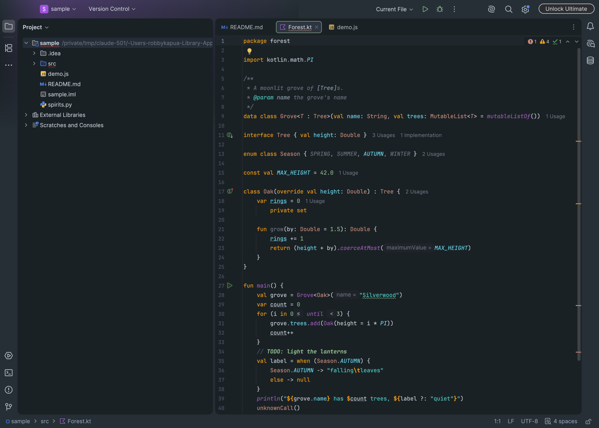
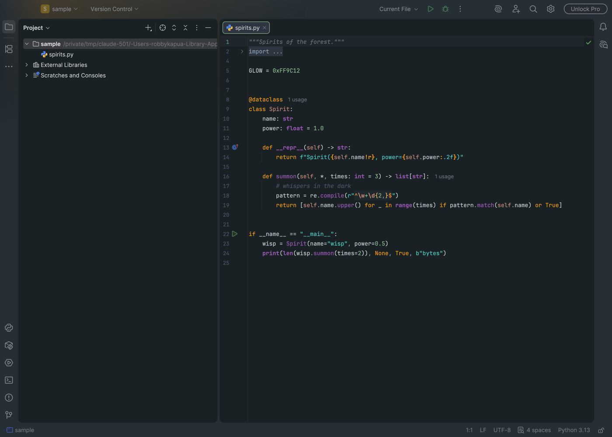
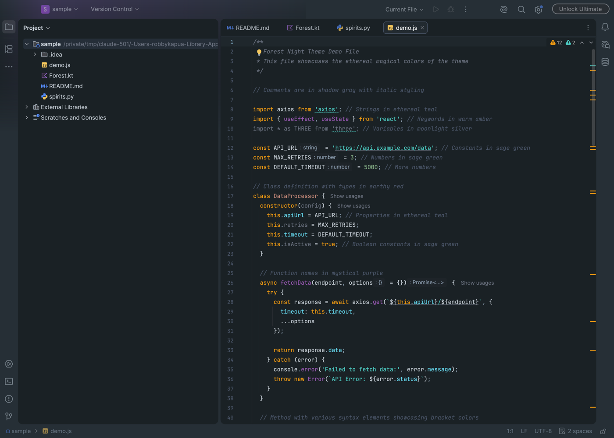

# Forest Night - Ethereal for IntelliJ

**This is not my theme.** Forest Night - Ethereal was designed by [Forrest Knight](https://github.com/ForrestKnight) for VS Code ([ForrestKnight/forest-night-theme](https://github.com/ForrestKnight/forest-night-theme)). This folder is only a faithful port of it to JetBrains IDEs, with the original colors kept as close as IntelliJ allows. All credit for the design goes to Forrest Knight.



## What's in the port

- `forest_night.theme.json`: the IDE theme, built on Islands Dark and recolored with the Forest Night palette.
- `forest_night.xml`: the editor color scheme. It maps the original's syntax colors onto IntelliJ's own highlighting keys and covers the colors Darcula would otherwise leak into Kotlin, Python, JS/TS, Markdown, SQL and other languages.

Where IntelliJ can't match VS Code:

- No rainbow brackets: IntelliJ has no built-in bracket-pair coloring.
- Translucent VS Code backgrounds are blended to solid colors, since IntelliJ schemes don't support transparency.
- ANSI black in the console matches the background, as in the original, so black text isn't visible.

Needs IntelliJ 2025.3 or later (any JetBrains IDE on that platform, such as PyCharm or DataGrip).

## Install

```sh
./build.sh
```

Then in the IDE: **Settings → Plugins → ⚙ → Install Plugin from Disk**, pick `build/forest-night-intellij.jar`, and choose **Forest Night - Ethereal** under **Appearance → Theme**. Building needs the `jar` tool from a JDK.

| Python in PyCharm | JavaScript |
| --- | --- |
|  |  |

## License

The original theme is MIT licensed © 2025 Forrest Knight, and so is this port; see [LICENSE](LICENSE). The rest of this repo is under its own license.
